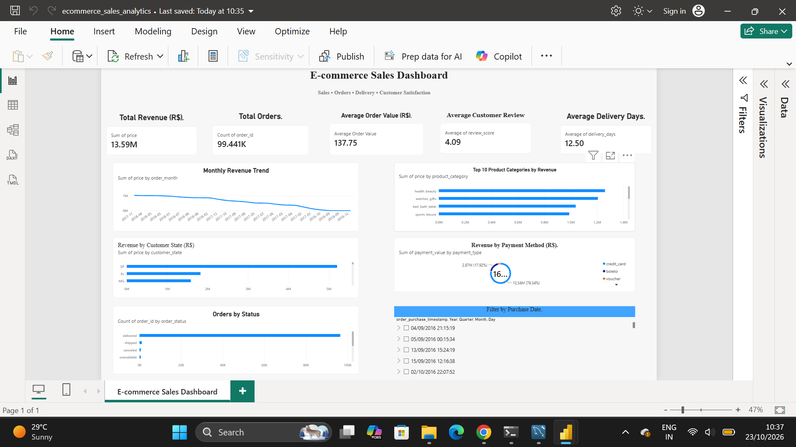
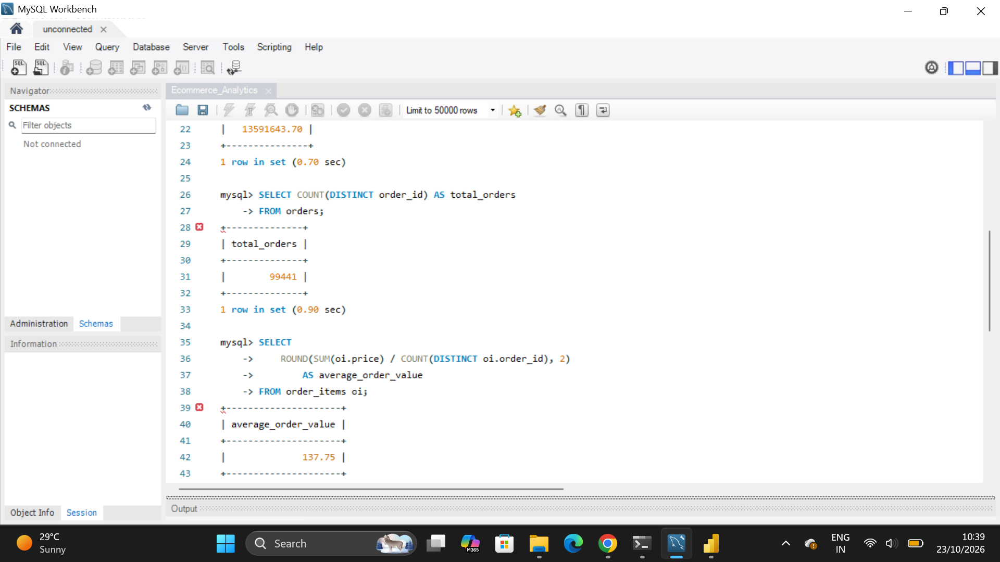

# E-commerce Sales Analytics Dashboard

## 📌 Project Overview

This project analyzes the Brazilian E-Commerce Public Dataset by Olist to understand sales performance, order trends, product categories, payment methods, delivery performance, and customer satisfaction.

The objective is to transform raw e-commerce data into meaningful business insights using **MySQL and Power BI**.

## 🎯 Business Objectives

- Analyze sales revenue and order performance.
- Identify monthly revenue trends and top-performing product categories.
- Understand order status and payment method distribution.
- Compare revenue across customer states.
- Evaluate delivery performance and customer satisfaction.
- Present key performance indicators through an interactive Power BI dashboard.

## 🛠️ Tools & Technologies

- **MySQL** — data querying and analysis
- **SQL** — joins, filtering, aggregation, grouping, and date calculations
- **Microsoft Power BI** — dashboard development and data visualization
- **CSV files** — source data

## 📊 Key Performance Indicators (KPIs)

| KPI | Result |
|---|---:|
| Total Item Revenue | R$13.59 million |
| Total Orders | 99,441 |
| Average Order Value | R$137.75 |
| Average Delivery Time | 12.50 days |
| Average Customer Review Score | 4.09 / 5 |

**Metric definitions:** Total item revenue is calculated as the sum of product item prices and excludes freight. Average order value is calculated by dividing item revenue by the number of distinct orders represented in the order-items data. Delivery time is the average number of days between purchase and customer delivery for delivered orders with valid dates.

## 🔍 Key Business Insights

- **Monthly sales:** November 2017 recorded the highest monthly item revenue in the analyzed dataset.
- **Product categories:** Health and beauty was the highest-revenue product category.
- **Payment methods:** Credit cards accounted for the largest recorded payment value and were the most frequently recorded payment method.
- **Customer locations:** São Paulo had the highest customer count among the cities analyzed.
- **Delivery performance:** Approximately 91.89% of delivered orders with valid delivery dates arrived on or before the estimated delivery date.
- **Customer satisfaction:** The average review score was 4.09 out of 5.

These findings can help businesses understand sales patterns, product performance, customer behavior, and delivery operations.

## 📈 Power BI Dashboard Features

- KPI cards for revenue, orders, average order value, delivery time, and review score
- Monthly revenue trend analysis
- Top 10 product categories by revenue
- Order status distribution
- Revenue by customer state
- Revenue by payment method
- Date slicer for exploring the report by date

## 📸 Project Screenshots

### Dashboard Overview

### SQL Analysis

## 🗂️ Project Files

- **`Ecommerce_Analytics.sql`** — SQL queries used for the analysis.
- **`screenshots/`** — screenshots of the Power BI dashboard and SQL analysis.
- **`Ecommerce_Analytics.pbix`** — Power BI report file, available on request.

*Note: The Power BI report file is not currently uploaded to this repository because it exceeds GitHub's standard browser-upload limit.*

## 🧰 Skills Demonstrated

- SQL data analysis
- Data aggregation and business KPI calculation
- Sales trend and category performance analysis
- Data visualization using Power BI
- Customer satisfaction and delivery performance analysis
- Communicating business insights through dashboards

## 📚 Dataset

This project uses the **Brazilian E-Commerce Public Dataset by Olist**, a public dataset containing information about orders, customers, products, sellers, payments, and reviews.

**Dataset source:** [Brazilian E-Commerce Public Dataset by Olist — Kaggle](https://www.kaggle.com/datasets/olistbr/brazilian-ecommerce)

The dataset is publicly available for analysis. Download it from the source and import the required CSV files into MySQL to reproduce the analysis.

## 🚀 How to Explore the Project

1. Download the Olist dataset from the Kaggle link above.
2. Import the required CSV files into MySQL.
3. Open `Ecommerce_Analytics.sql` and run the relevant SQL queries.
4. Review the screenshots in the `screenshots/` folder to see the dashboard and SQL analysis.
5. Request the Power BI `.pbix` file if you would like to explore the interactive report.

## 👩‍💻 Author

**Sanjana Biradar**

Aspiring Data Analyst | MySQL | Power BI | SQL | Data Visualization

[GitHub Profile](https://github.com/sanjanabir)
